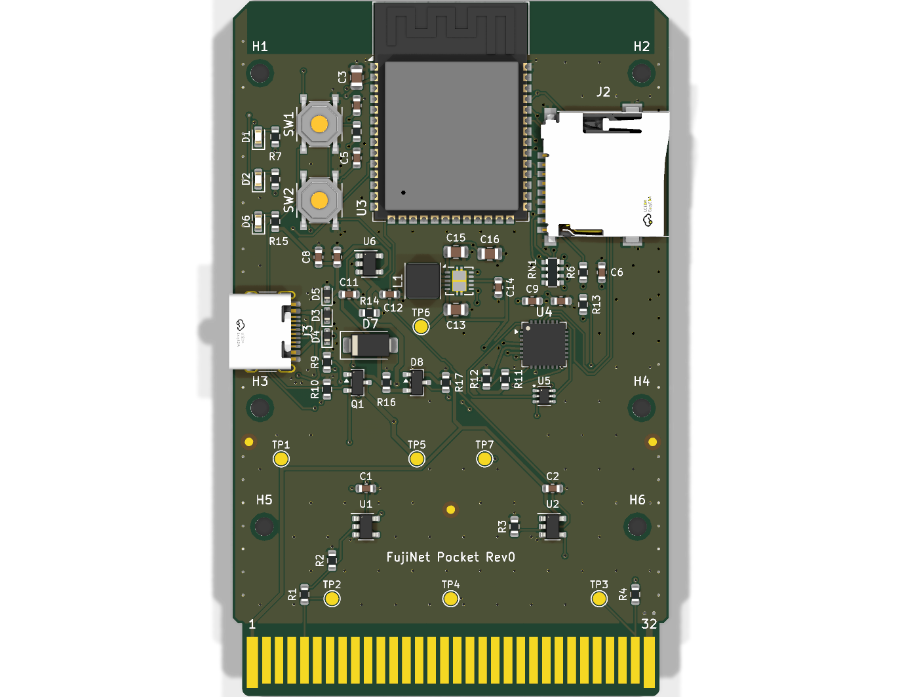
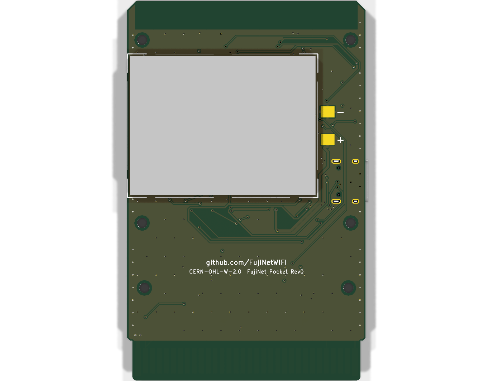

# FujiNet Pocket Rev0 (draft)

A **FujiNet for the Analogue Pocket's cartridge slot**. On the Pocket the FPGA core is the
cartridge:
- It serves the console's FujiNet mailbox to the running program.
- It sends each request as a FujiBus packet in a SLIP frame at 115,200 baud 8N1, on cartridge
  pin 5, and listens on pin 31.

This board is therefore only the FujiNet half of a FujiNet cartridge: no bus logic, no SRAM, no
console-side microcontroller. It is the same for every Pocket core that speaks this link. The
first is openFPGA-7800 (2.2.7: CONFIG, the network devices and game loading, tested with
fujinet-pc on the link port). An Intellivision core and a 2600 core are scoped to follow.
Cores of the cart's own, a net terminal and a text web browser, are scoped in
[docs/NET_CORES_SCOPING.md](docs/NET_CORES_SCOPING.md).

**Status (2026-11-20): draft, schematic and board.** It is placed and routed, but has not
been ordered, built or run, and has not been fitted to a Pocket.

| Check | Result |
|---|---|
| ERC (all severities) | 0 errors, 0 warnings |
| Netlist parity (kicad-cli netlist vs `tools/design.py`) | 41 / 41 nets |
| `tools/check_pins.py` (the netlist vs `firmware/pocket.h`, plus the link path) | pass |
| DRC, errors, with schematic parity | 0 violations, 0 unconnected, 0 parity |
| DRC warnings | 4: 2 dangling stitch vias, 2 silk near the edge |
| Shell, fit in a Pocket | draft shell drawn (`case/`), not yet printed or fitted |

`tools/build_all.sh` regenerates the schematic and the checks; `LAYOUT=1 tools/build_all.sh`
also regenerates the board and its outputs. It needs:
- KiCad 10 and Python 3;
- for the board, KiCad's pcbnew Python module (`PCBNEW_PYTHON`, default `/usr/bin/python3`) and
  numpy;
- Freerouting 2.4.1, which needs Java 25 (`JAVA` names the binary).
- The circuit lives in `tools/design.py`.
- The sheet drawings live in `tools/sch_layout.py`.
- The `.kicad_sch` files are output: edit the Python, not them.
- The generator, the drawing toolkit and its checks are FujiNet-7800-Rev0's (`ATARI-7800/`).

## Block diagram

```
Pocket slot ──pin 5──100R──[LVC1G34 on +3V3]──────── UART1 RX (IO17) ┐
            ──pin 31─100R──[LVC1G34 on CART_VCC]──── UART1 TX (IO18) ├ ESP32-S3-WROOM-1-N16R8 ── microSD
            ──pin 1 (CART_VCC) ─┐                                    │   UART0 ── CP2102N ── USB-C
                                └─ BAT54C ─ PWR_EN ─ TPS63001 (3.3 V)┘                         │
                                     VBUS ─┘           ▲ VSYS                                  │
                         LiPo ── AO3401A ──────────────┤                                       │
                          ▲                 SS34 ──────┘◄────────────── VBUS ◄────────────────┘
                          └── MCP73831 (4.20 V, 213 mA) ◄── VBUS
```

## The slot side (sheet 2)

The Pocket's slot is a GB / GBA edge: 32 fingers at 1.5 mm on one face.

| Pin | GBA / GB name | Net | Use |
|---|---|---|---|
| 1 | VCC | CART_VCC | The cart rail: 3.3 V while the Pocket runs with cart power on. The core asks for it (`core.json` `cartridge_adapter` 0). |
| 5 | /CS | POCKET_TX | The core's TX, idle high. |
| 31 | /REQ (GB: VIN) | POCKET_RX | The core's RX. |
| 32 | GND | GND | |
| others | | open | Analogue's template leaves them as they are: bank 0 an output held high, the rest inputs. |

- **Two SN74LVC1G34 buffers, both with Ioff** (partial power-down), so neither side ever feeds the
  other when it is off:
  - **RX buffer:** runs on the device's +3V3.
  - **TX buffer:** runs on the Pocket's own rail (pin 1).
  - The Pocket can be on with the device's cell flat, and the device can be on (charging, flashing)
  with the Pocket off.
- **100R in series at each finger.**
- **100k pull-downs** hold an unpowered side's line low:
  - The core counts a line only once it has idled high for 1 ms, so a low pin 31 is never heard.
  - The S3 sees a break, not noise.
- **Pin 1 also feeds the enable diode:** about 30 uA.

**Edge geometry** (`tools/make_edge_fp.py`) is re-drawn from Gekkio's GB-CART32K-A (gb-hardware,
CC-BY-4.0):
- pins 2-31 are 1.0 x 5.5 mm;
- pins 1 and 32 are 1.3 x 6.0 mm, so the rail and ground make contact first;
- the tab is 49.2 x 8.6 mm;
- the board is 1.0 mm thick.

**To verify on a Pocket before ordering boards:** which face the fingers are on, and pin 1.

## The FujiNet half (sheets 3 and 4)

FujiNet-7800-Rev0's circuits, unchanged except as noted:
- **ESP32-S3-WROOM-1-N16R8:** with its EN RC, S3_RST and S3_BOOT buttons, and 22 uF bulk.
- **microSD:** TF-015, SPI, with pull-ups.
- **USB-C:** HRO TYPE-C-31-M-12, 5.1k Rd, ESD.
- **CP2102N:** on UART0, with the UMH3N esptool auto-program pair.

Changed:
- **The link:** UART1 on IO17 (RX) and IO18 (TX) replaces the RP2354B's native USB and its
  RUN / BOOTSEL lines.
- **Status LEDs:** two plain LEDs, active low from +3V3, replace the WS2812C, which needs 3.7 V
  or more; this board has no 5 V rail.
  - WiFi: green, IO14.
  - Bus: red, IO16.

## Power (sheet 5)

The device powers itself. The Pocket's cart rail has only been seen to supply about 0.2 W. An
ESP32-S3 on WiFi averages more than that and peaks several times higher (openFPGA-7800
`docs/FUJINET_POCKET_DEVICE.md`, section 5).

- **Cell:** a protected 1S LiPo pouch up to 30 x 50 x 5 mm, for example a 403050 or 503050
  (about 600-1000 mAh). It rides over the components on a shelf in the shell (layout below), with
  its leads soldered to two pads on the board, marked + and -. There is no connector, so there is
  no JST-PH polarity to get wrong.
  - The board has no protection circuit of its own: the cell's is relied on.
  - The cell is bought separately and is not on the BOM.
- **Charger:** MCP73831-2 (4.20 V), 213 mA (R_PROG 4.7k, about 0.5 C for 400 mAh), from USB
  only, with a charge LED.
- **Power path** (Microchip AN1149, as the 7800 board's 5 V OR):
  - USB VBUS goes through an SS34 onto VSYS.
  - The cell goes through an AO3401A, gate on VBUS: on without USB, off with it, so USB runs the
    board while the cell charges.
  - 4.7k holds the gate down against the SS34's leakage.
- **3.3 V:** a TPS63001 buck-boost, 1.8-5.5 V in. It holds 3.3 V over the cell's whole 3.0-4.2 V
  and through WiFi bursts.
  - PS/SYNC is tied low: power-save mode at light load.
- **Enable:** `PWR_EN = CART_VCC or VBUS` (BAT54C, 100k down).
  - The board runs while the Pocket is on, or while USB is in (charging, flashing).
  - Otherwise the regulator is shut down: no power switch is needed.

## Firmware

`firmware/pocket.h` and `firmware/platformio-fujinet-pocket.ini` are proposed for fujinet-firmware
as `include/pinmap/pocket.h` and `build-platforms/platformio-fujinet-pocket.ini`:
- **The build:** the generic RS232 build (`BUILD_RS232`) on a wired UART, as `rs232_s3.h`.
- **Pin assignments:**
  - **UART1:** the link, on 17 and 18. Defining `PIN_UART1_RX` is what selects the wired UART in
    `lib/bus/rs232/rs232.h`.
  - **SD and UART0:** as `fujiversal-rs232.h`.
  - **LEDs:** on 14 and 16.
  - **Not used:** the modem control lines and keys.cpp's buttons are `GPIO_NUM_NC`.
    `common.h` would otherwise put button C on GPIO14, this board's WiFi LED.

`pinmap.h` also needs its `#include "pinmap/pocket.h"`. Neither file has been compiled yet.


**It is also a modem.** The stock RS232 firmware passes any bytes outside
FujiBus frames to FujiNet's Hayes-style modem: a terminal core on the cart's
pins (NetTerm, Mode FujiNet Modem) dials Telnet BBSs with `ATDT host:port`.
See `docs/NET_CORES_SCOPING.md`, section 2.
## The board

 

- **Size and stack:** 51.4 x 82 mm, 1.0 mm thick, 4 layers:
  - F.Cu: signals and a GND pour;
  - In1: GND plane;
  - In2: +3V3 plane;
  - B.Cu: signals and a GND pour.
- **The tab:** the GB / GBA tab with its 32 fingers. The insertion corners are 0.9 mm arcs, as a
  GB cartridge's.
- **The voltage-switch corner:** on the left (pin 1's side, seen from the component side with
  the fingers down), the tab's edge runs straight on up 10 mm past the tab base before the body
  steps out to full width. The shell's GBA-shaped corner there then clears the Pocket's voltage
  switch. The height is an **estimate** (`gen_pcb.NOTCH_H`).
- **The Pocket's cartridge recess** (estimates, both drawn on the board's Fab layers):
  - **Back:** below about 31 mm from the insertion edge, the board's flat back lies nearly flush
    against the Pocket. Nothing is placed on the back.
  - **Front** (the component side, the fingers' side): it faces the recess's open side, covered
    only by the Pocket's lip below about 15 mm from the insertion edge. Only low parts go there:
    the two link buffers over pins 5 and 31, the bring-up pads, the cell's lead pads.
- **Above the recess, on the front:**
  - the ESP32-S3 at the top, its antenna flush with the top edge over its keep-out band (no
    copper, holes or parts across the board there);
  - USB-C on the west side and microSD on the east side;
  - the reset and BOOT buttons and the three LEDs down the west side;
  - below the module: the charger and power path, the TPS63001, the CP2102N.
- **The battery, on a shelf in the shell:**
  - the cell lies over the components, on a shelf whose top face is 4.4 mm above the board. The
    tallest parts under it are the module and USB-C, at 3.1-3.2 mm.
  - its place, 30 x 50 mm (x 88..118, y 79..129), is drawn on F.Fab and in the shell anchors. It
    is clear of the antenna band and the two buttons.
  - its leads come down from its lower end to two pads on the component side, just above the lip:
    `+` at the east, `-` at the west.
  - the 3D export shows a 30 x 50 x 4 mm stand-in at that height.
  - nothing is placed on the back, so assembly is single-sided.
- **Six M2 holes** (2.2 mm) for the shell, each kept 3 mm clear of parts:
  - two by the top corners, below the antenna band;
  - two just above the slot line;
  - two inside the slot.

  `case/board-anchors.json` and `.scad` carry them for the shell design, with the outline, the
  ports, buttons, LEDs and the cell. `case/README.md` lists what the shell must respect: the
  GBA-shaped corner, the antenna, the openings and the cell's room to swell.
- **Routing:** generated, as for FujiNet-7800-Rev0. The order:
  1. `tools/gen_pcb.py` places the parts from `tools/placement.py` and fans out the planes. It also
     lays four things down by hand, locked:
     - the TPS63001's pins, to its inductor and capacitors as its datasheet shows, and its VIN /
       VINA loop;
     - the USB pair: the USB-C crossover (D- under it on B.Cu, through two 0.45 / 0.2 mm vias),
       on to the ESD diodes, then on B.Cu under the SS34 and the power path to the CP2102N's
       pins 4 and 5;
     - the UART0 escapes from the module to B.Cu;
     - the GND finger's stub.
  2. Freerouting routes the rest.
  3. The 7800 board's finisher closes what is left; stitching vias tie the GND pours to In1.
- **Outputs** (`tools/export_fab.py`): `exports/`
  - gerbers and drill;
  - the front position file;
  - `FujiNet-Pocket-Rev0.step` (the board with every model and the cell's stand-in, for the
    shell);
  - the renders in `docs/`.

## Measure with the breakout cart

These numbers are estimates in the board and shell; each is one setting in `tools/gen_pcb.py`
(and `tools/placement.py` for the slot line), then `LAYOUT=1 tools/build_all.sh` re-runs the
layout and the shell anchors.

| # | Measure | Now (estimate) | Setting |
|---|---|---|---|
| 1 | **Voltage switch:** how far above the tab base the left corner must stay at the tab's width | 10 mm | `NOTCH_H` |
| 2 | **Seated depth:** how far from the insertion edge the board's back starts lying against the Pocket | 31 mm (y = 119) | `SLOT_Y` (gen_pcb.py and placement.py) |
| 3 | **Lip:** how far up the component side the Pocket's lip covers (low parts only below) | 15 mm (y = 135) | `LIP_Y` (gen_pcb.py and placement.py) |
| 4 | **Board thickness** the slot wants | 1.0 mm (Gekkio's GB boards) | `THICKNESS` |
| 5 | **Pin 1 side:** VCC (pin 1) on the left, seen from the contact side with the fingers down | as Gekkio's footprint | `make_edge_fp.py` |

**Final pass, after the measurements and the re-route:** clear the DRC warnings left then.
Today these are 2 dangling stitching vias and 2 silkscreen texts near the edge. Re-check the
renders and the shell anchors, and fit a printed blank.

## Before ordering boards

1. **Edge:** check the finger face, pin 1 and the board thickness (1.0 mm, as Gekkio's GB
   boards) against a GB cartridge in a Pocket. Measure where the Pocket's shell top falls on the
   board (31 mm from the insertion edge is assumed), and how far up the component side the
   Pocket's lip covers it (15 mm is assumed: only low parts below). Measure the voltage switch
   and size the left corner's step for it (10 mm above the tab base is assumed).
2. **Shell:** print a blank with the GBA-shaped corner first, and check that it seats fully and
   clears the voltage switch and the shoulder buttons (`case/README.md`).
3. **Sourcing:** no LCSC code chosen yet for SN74LVC1G34DBVR, MCP73831T-2ACI/OT, TPS63001DRCR,
   SWPA4030S1R5NT and the green LED (`FujiNet-Pocket-Rev0-BOM.csv`).
4. **The inductor's saturation current** against the TPS63001's switch current limit (datasheet).
5. **The microSD card-detect polarity:** it is wired to IO42 and set NC in `pocket.h` until known.
6. **The back in the recess:** check that the board's back, with its tented vias and silk,
   slides against the Pocket without catching. The USB-C's shell legs and the microSD's pegs come
   through it above the recess.
7. **Fab review:**
   - the 4-layer, 1.0 mm stack;
   - hard gold on the fingers, with a bevel;
   - the 0.45 / 0.2 mm vias;
   - JLCPCB's placement preview (no CPL rotation corrections are made for this board yet).
8. **Compile `pocket.h`** in fujinet-firmware; offer the pin map upstream once a board has run.
9. **Silkscreen:** the link to github.com/FujiNetWIFI is on the back, as this repository's notice
   requires.

## Files

| Path | What |
|---|---|
| `tools/design.py` | The circuit: every part, value, footprint, MPN, LCSC code and net. |
| `tools/sch_layout.py` | How each sheet is drawn. |
| `tools/gen_sch.py`, `sch_draw.py`, `sexpr.py` | The generator and its checks (FujiNet-7800-Rev0's). |
| `tools/harvest_symbols.py`, `symcache.sexpr` | The stock symbols embedded in the sheets. |
| `tools/make_edge_fp.py` | The slot edge footprint. |
| `tools/make_fp_extra.py` | The cell's lead pads footprint. |
| `tools/make_cell_step.py` | The cell's stand-in 3D model (a 30 x 50 x 4 mm box at shelf height, STEP written by hand). |
| `tools/placement.py`, `tools/gen_pcb.py` | Where every part goes; the board generator (outline, holes, planes, keep-outs, the pre-routes, the shell anchors). |
| `tools/fanout.py`, `route.py`, `finish_route.py`, `drc_fix.py`, `tidy_tracks.py`, `stitch_gnd.py`, `check_vias.py`, `fix_silk.py`, `fill_zones.py`, `set_models.py`, `route_board.sh` | Plane fan-out, Freerouting, the finisher and clean-up (FujiNet-7800-Rev0's). |
| `tools/export_fab.py` | Gerbers, drill, positions, STEP, renders. |
| `FujiNet-Pocket-Rev0.kicad_pcb` | The board (generated). |
| `case/` | The draft shell (`FujiNet-Pocket-Shell.scad`, STLs in `case/stl/`), its notes, and the board's anchors for it. |
| `3d/` | The 3D models (FujiNet-7800-Rev0's set, plus the cell's stand-in). |
| `exports/` | The fab and STEP outputs. |
| `tools/check_pins.py` | The netlist against `firmware/pocket.h` and the link path. |
| `tools/bom.py` | `FujiNet-Pocket-Rev0-BOM.csv`. |
| `firmware/` | The proposed fujinet-firmware pin map and build env. |
| `docs/FujiNet-Pocket-Rev0-schematic.pdf` | The schematic. |
| `docs/NET_CORES_SCOPING.md` | Scoping note: other cores for the cart (a net terminal, a text web browser) and why an "update cores" core isn't possible today. |

## Provenance and license

**CERN-OHL-W-2.0**, as FujiNet-7800-Rev0.
- **The FujiNet half, the generators and the drawing toolkit:** `ATARI-7800/FujiNet-7800-Rev0` in
  this repository, and through it SMS / NES Rev0.
- **The slot side, the LEDs and the power sheet:** new.
- **Edge geometry:** Gekkio, gb-hardware GB-CART32K-A, CC-BY-4.0 (measurements re-drawn).
- **The link protocol and pins:** openFPGA-7800 (MIT), `docs/FUJINET_POCKET_DEVICE.md`,
  `src/fpga/core/fujinet_mailbox.sv`.
- **Symbols and footprints:** official KiCad libraries (CC-BY-SA 4.0 with exception), except the
  project's own (the Pocket edge; the TF-015 microSD from FujiNet-7800-Rev0).
