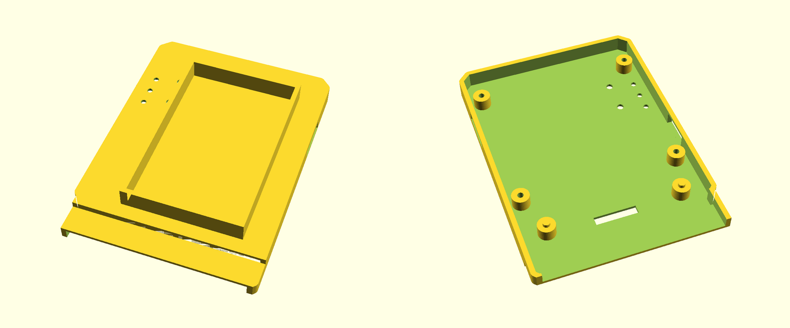
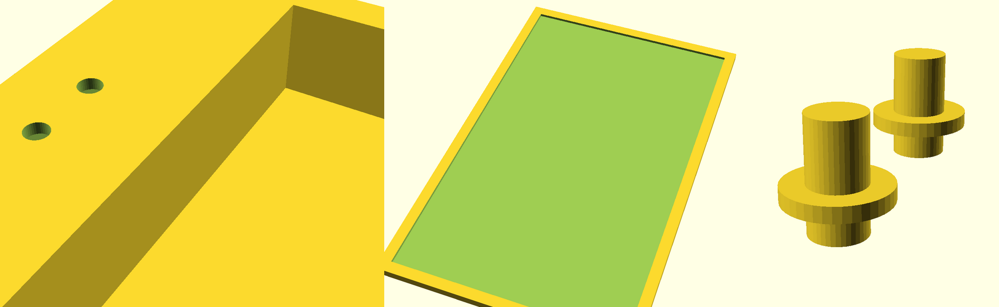

# Shell notes (draft)

No shell is designed yet. This is what the board gives a shell, molded or printed, and the limits
it has to respect.

## The draft shell

`FujiNet-Pocket-Shell.scad` (OpenSCAD 2021.01) builds three parts from `board-anchors.scad`, so it
follows the board whenever the layout is re-run. Pick the part with `-D 'part="front"'`, `"lid"`,
`"plungers"`, `"back"`, `"assembly"` or `"all"`; ready STLs are in `stl/`.

| Part | What | Print |
|---|---|---|
| **front** | Walls round the board and a roof over the parts, 0.3 mm above the tallest. The roof is the battery shelf. On top: the battery bay. Below the lip: a low band, stopping just above the fingers. The USB-C (west) and microSD (east) windows. Guide collars for the two button plungers. Light-pipe holes (1.6 mm) over the three LEDs. The cell's lead slot over its pads. Bosses at the six holes: M2 pilots at the four above the recess, locating pins through the two inside it. | Roof down; supports only under the side windows |
| **lid** | Closes the battery bay, with a locating lip. Its face has the label recess: 0.4 mm deep, 1.5 mm in from the edges, about 31 x 51 mm. | Face down |
| **plungers** (2) | For the S3 reset and BOOT buttons. A 2.2 mm stem through a guide collar on the roof. A 4 mm flange under the roof keeps each one captive: fit them from inside before the board goes in. The top stands 0.6 mm above the collar, beside the battery bay's wall: press with a fingertip or nail, which also keeps them from being pressed by accident. | Standing on the stem's foot; the flange's 0.9 mm overhang needs no support |
| **back** | A plate over the board's back above the recess only, 1.3 mm off the board (the USB-C legs stand about 1 mm proud). Four M2 counterbored holes. Inside the recess the board's back stays bare, flush against the Pocket. | Outside down |

**Fasteners:** 4x M2 x 8 pan head, from the back plate through the board into the front's bosses.
The pilots are 1.7 mm for self-tapping; open them to 3.2 mm for M2 heat-set inserts.

**Light pipes (not printed):** each LED is 3.6 mm under the 0.8 mm roof, so a pipe is about 4.4 mm
long. Options:
- **1.5 mm clear acrylic rod or end-glow optical fibre:** cut to 4.5 mm, pushed through the hole
  to just above the LED, held with a drop of CA or UV glue.
- **Off-the-shelf press-fit light pipes:** Bivar, Dialight or Lumex round PC / acrylic pipes. Set
  `led_d` to the part's barrel.
- **Clear UV resin or epoxy:** fill each hole flush from outside.
- **Translucent filament:** print the front in it and leave a 0.4 mm skin over each hole.

**Overall thickness:** board 1.0 + the parts' roof 4.4 + cell 5.0 + 0.5 + lid 1.2 = about 12 mm
over the battery, from the board's back. The back plate adds 2.3 mm above the recess only.

**Draft:**
- Every recess number comes from the estimates in `board-anchors.scad`. Print the front and fit it
  to a Pocket before anything else.
- Still to come:
  - snap fits in place of screws, if wanted;
  - rounding.

## Inputs

All of these are generated: run `tools/gen_pcb.py`, then `tools/export_fab.py`.

| File | What |
|---|---|
| `case/board-anchors.json`, `case/board-anchors.scad` | Board outline, thickness, the six holes, the cell's place on its shelf (`cell`, `shelf_z`) and its lead pads, the USB-C and microSD mouths, buttons, LEDs, antenna, and the recess lines (`slot_y`, `lip_y`). KiCad frame: mm, y down, front = the component side. |
| `exports/FujiNet-Pocket-Rev0.step` | The board with every part and a 30 x 50 x 4 mm stand-in for the cell at shelf height, for the CAD the shell is drawn in. |

## The board in the Pocket

- **Board:** 51.4 x 82 mm, 1.0 mm thick.
  - Bottom 8.6 mm: the Game Boy-style tab, 49.2 mm wide, with the 32 fingers.
  - About 31 mm, measured from the insertion edge, goes into the Pocket's cartridge recess
    (`slot_y`). This is an **estimate**: measure it on a Pocket.
- **Back** (the flat side): in the recess it lies nearly flush against the Pocket.
  - Nothing is placed on the back anywhere. The shell has no wall there inside the recess, or only
    a thin skin if the fit allows.
  - Above the recess, the USB-C's four shell legs and the microSD's two locating pegs come
    through the back, about 1 mm proud.
- **Front** (the component side, the fingers' side): in the recess it faces the open side.
  - The Pocket's lip covers it below about 15 mm from the insertion edge (`lip_y`, an
    **estimate**). Only low parts go there: SOT-23-5 (1.45 mm), 0603s, flat pads.
  - Above `lip_y` the front is open. The parts are 3.3 mm at most (ESP32-S3 module 3.1 mm, USB-C
    3.2 mm).

## The battery shelf

- The cell (a protected 1S LiPo up to 30 x 50 x 5 mm, e.g. a 403050 or 503050) rides over the
  components on a shelf in the shell.
  - It lies over the board at `cell` (x 88..118, y 79..129).
  - The shelf's top face is `shelf_z` = 4.4 mm above the board: the tallest parts under it plus
    0.4 mm clearance, plus a 0.8 mm shelf.
  - It is clear of the antenna band (the top 7 mm) and of the two buttons.
- Its leads come down from its lower end, where a pouch's protection board is, to the two pads at
  `cell_leads`, just above the lip: `+` 3 mm east, `-` 3 mm west. Leave a channel for them.
- **Thickness:** from the board's back, about 1.0 (board) + 4.4 (shelf) + 5.0 (cell) + 0.5
  (swelling room) + the front wall, about 11-12 mm over the cell.
  - Below `lip_y` the shell keeps to a GB cartridge's profile.
- **Hold the cell, don't pot it:** LiPo pouches swell with age. Use foam tape on the shelf and
  about 0.5 mm of room over the cell. The shelf must not press on the parts under it.

## Must

1. **Voltage switch:** the lower corner over the Pocket's voltage switch must be **GBA-shaped**,
   so the switch is never pressed and the slot stays at 3.3 V. A GB/GBC corner puts the slot at
   5 V. Cut it 0.5-1 mm deeper and wider than a GBA cart's. On that side the board keeps the
   tab's width for 10 mm above the tab base (`switch_notch`, an estimate), so the corner has
   room. Print a
   blank first and check that it seats fully and clears the switch.
2. **Antenna:** keep the top 7 mm (the module's antenna, flush with the top edge) under plastic
   only: no metal, no screws, no ink or paint with metal in it, and a thin wall. The cell stops
   below it.
3. **Openings:**
   - USB-C, west side, plug in from the west;
   - microSD, east side, card in from the east, under the shelf's edge;
   - the two buttons (S3 reset, S3 BOOT), by plungers or pin holes, west of the shelf;
   - the three LEDs on the west edge (WiFi, bus, charge), by light pipes or thin windows.
4. **Holes:** six M2 holes (2.2 mm), with 3 mm around each kept free of parts:
   - two below the antenna band;
   - two just above `slot_y`;
   - two inside the recess.

   Use them for screws into heat-set inserts, or for locating pins when molding around the board.
   The shelf can stand on bosses over them. Inside the recess the back has no room for screw
   heads: use them from the front there, or as pins.

## Watch

- **The back in the recess** must slide against the Pocket without catching.
- **Shoulder buttons:** the shell is no wider than a GB cartridge (57 mm) where it stands
  between them.
